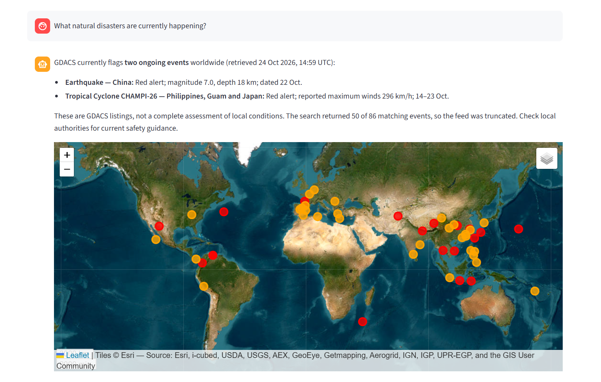
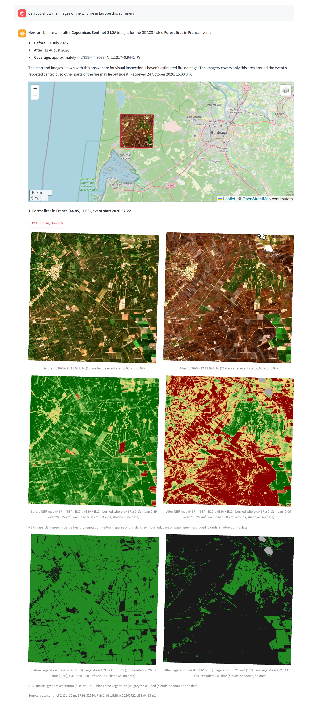
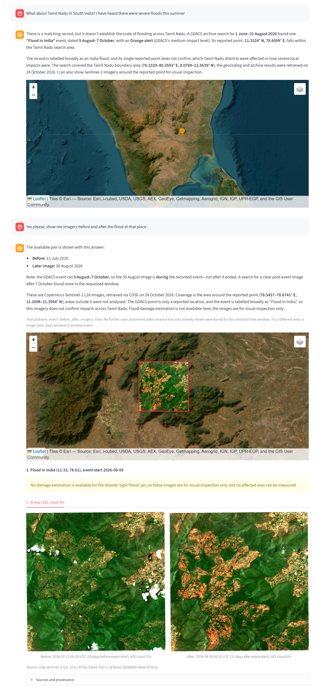
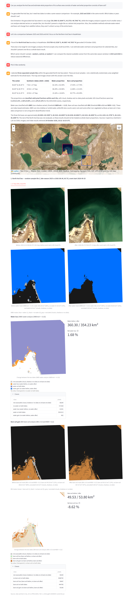

# Earth Observation Agent for Natural Disaster & Climate Change Monitoring [WIP]

This project demonstrates an interactive AI assistant for earth observation, to which users can ask questions about climate change or natural disasters that have occurred around the world. An LLM agent running in the background searches for events or satellite images the user is interested in. Furthermore, the agent picks before/after imagery and conducts analyses to estimate changes between these images.

## Current Features
- **LLM agent**: Implementation of an AI agent using the OpenAI Agents SDK.
- **Remote Sensing Data Retrieval**: Calling the Sentinel Hub Catalog API to retrieve Sentinel-2 L2A data at 10 m resolution (20 m bands are scaled up to 10 m) from the Copernicus Data Space Ecosystem and additionally Element84's Earth Search as the public fallback. Image scenes are then chosen by the agent using cloud cover, coverage and closeness to the event the user has requested.
- **Natural Disaster Search**: Utilizing ESA EVE's `gdacs` tool to find current and recent natural disasters registered in the Global Disaster Alert and Coordination System. For historical search, NASA's EONET archives are additionally used.
- **Quicklook**: Utilizing ESA EVE's `cdse` tool to get quick preview images from Sentinel-2 (L2A) and Sentinel-1.
- **Analysis Tools**: Various spectral analysis methods the agent can pick as tools to estimate:
    - Burn severity (e.g., caused by wildfire)
    - Vegetation loss (wildfire, drought, land degradation)
    - Water shrinking (drought impact on lakes, reservoirs and rivers)
    - Snow cover change (snow melt)
    - Bare soil gain (desertification, land degradation)
    - For all analysis methods, metrics, such as before/after km² or net loss in %, are calculated.
- **Chat UI**: Direct side-by-side comparison of the images and integration of an interactive world map including Esri World Imagery and OpenStreetMap base layers.

## Examples

Here are few examples of how the interaction with the AI assistant can look like. The `assets` folder provides more examples, including some where the system does not yet work as intended.

### Example 1: General Exploration

    

### Example 2: Wildfire in Europe

    

### Example 3: Flood in South India

    

### Example 4: Shrinking of the Aral Sea

    

## Techstack
- Python 3.11+
- OpenAI Agents SDK
- MCP
    - `mcp`, `fastmcp`
    - three unmodified ESA EVE servers (`gdacs`, `cdse`, `geocode`) and a custom `eo-analysis` server
- Pydantic: Schemas of the tool inputs and outputs, settings
- Streamlit and Folium (Chat UI and interactive map)
- Rasterio, xarray, rioxarray, NumPy (reading, writing and processing Sentinel-2 rasters)
- GeoPandas, Shapely, pyproj (geometry and geodesic area calculation)
- pystac-client (STAC search in Element84's Earth Search)
- API calls (GDACS, NASA EONET, CDSE)